

  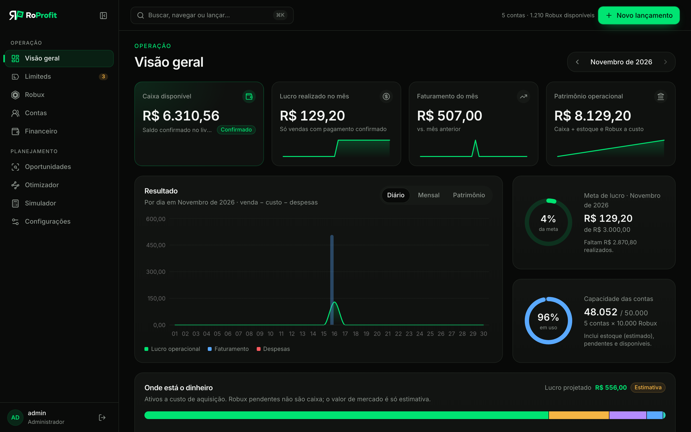

<h1 align="center">RoProfit</h1>

  Painel administrativo para a gestão de uma operação de revenda de Robux e Limiteds do Roblox: 
  estoque, contas, vendas, caixa e planejamento em um só lugar.

  
  
  
  
  

---

## Sobre

O RoProfit é um painel administrativo para gerenciar a revenda de Robux e itens Limited do Roblox. O painel acompanha o estoque da compra à venda e mostra quais itens estão em período de retenção, quais já podem ser vendidos e quais vendas ainda aguardam a liberação dos Robux.

A visão geral reúne faturamento, lucro realizado, saldo em caixa e progresso da meta mensal. Na área de contas, é possível acompanhar quanto cada conta já movimentou e quanto ainda pode enviar no mês. O otimizador usa essa capacidade para sugerir a distribuição dos itens. O simulador estima cenários de crescimento a partir do capital disponível, e a área financeira reúne o livro-caixa e as despesas da operação.

As capturas abaixo mostram a dashboard em funcionamento com dados fictícios.

## Destaques

- **Visão geral** — caixa, lucro realizado, faturamento, meta do mês e capacidade das contas.
- **Estoque de Limiteds** — ciclo de cada item (em hold → pronto para vender → Robux pendentes → Robux liberados) e uma galeria com todo o inventário.
- **Contas** — situação automática de cada conta, uso da capacidade e lucro por conta.
- **Otimizador** — sugere em qual conta cada Limited deve ficar para aproveitar ao máximo o limite de envio.
- **Simulador** — projeções de crescimento e de metas a partir do capital disponível.
- **Financeiro** — livro-caixa, despesas e resultado do mês.
- **Responsivo** — pensado também para o celular.
- **Integração com Discord** — bot que acompanha pedidos e avisa sobre anúncios de troca.

## Telas

| | |
|:---:|:---:|
| 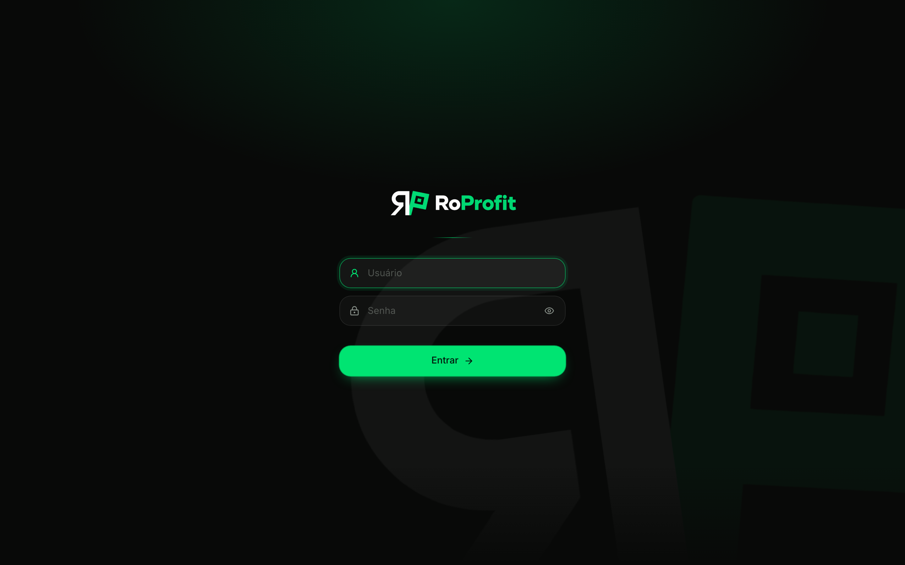 | 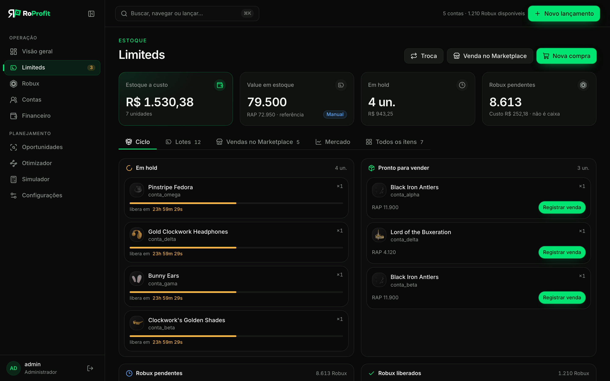 |
| **Login** | **Ciclo dos Limiteds** |
| 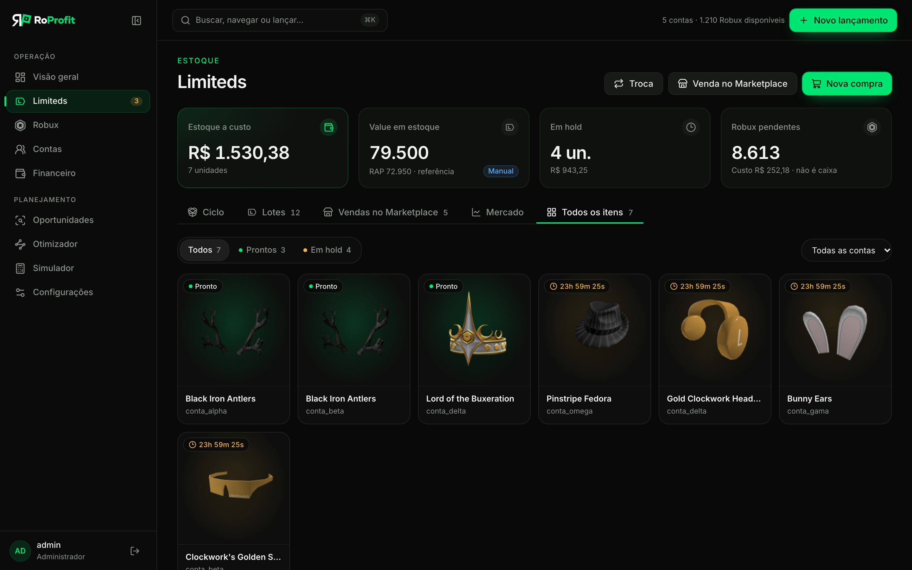 | 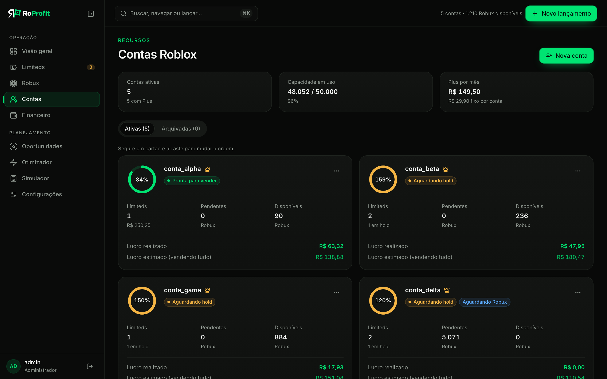 |
| **Galeria do estoque** | **Contas** |
| 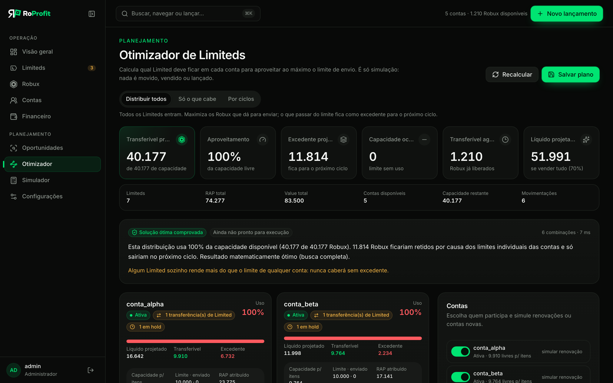 | 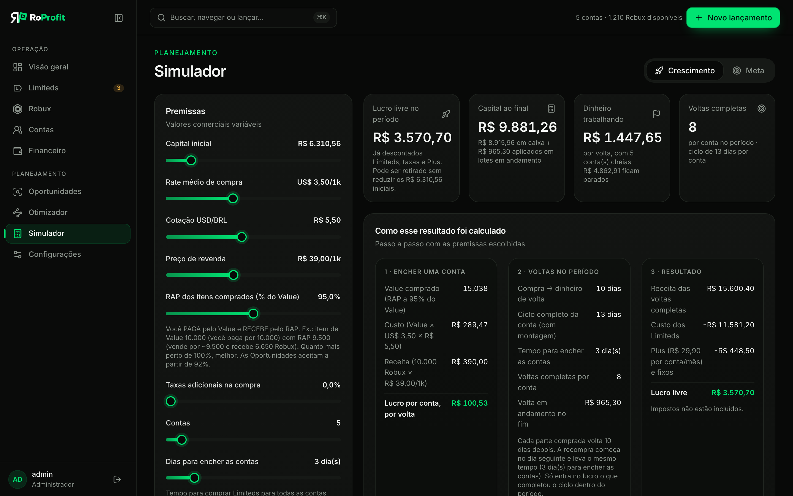 |
| **Otimizador** | **Simulador** |
| 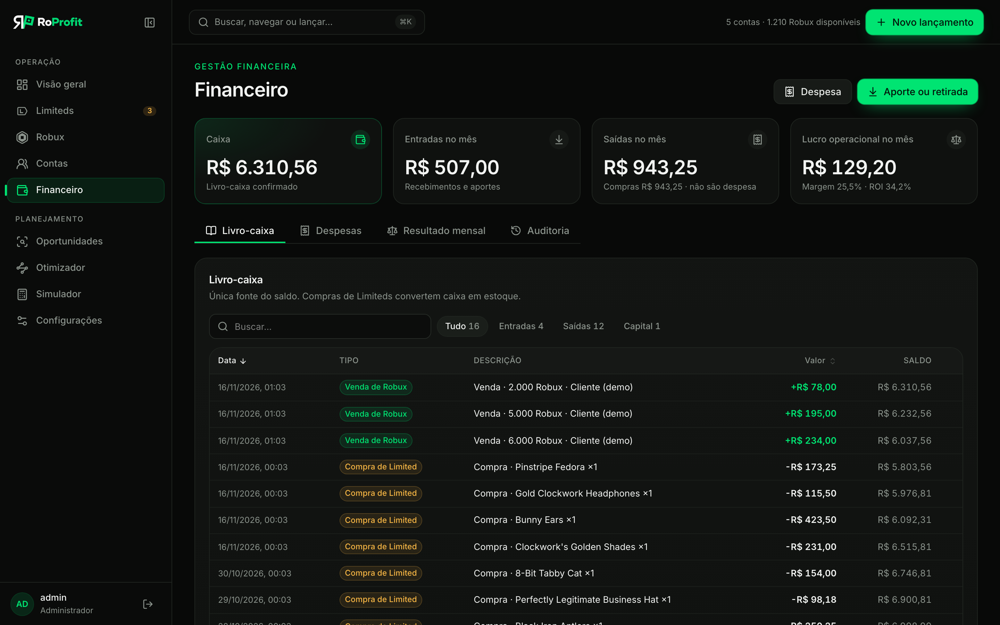 | 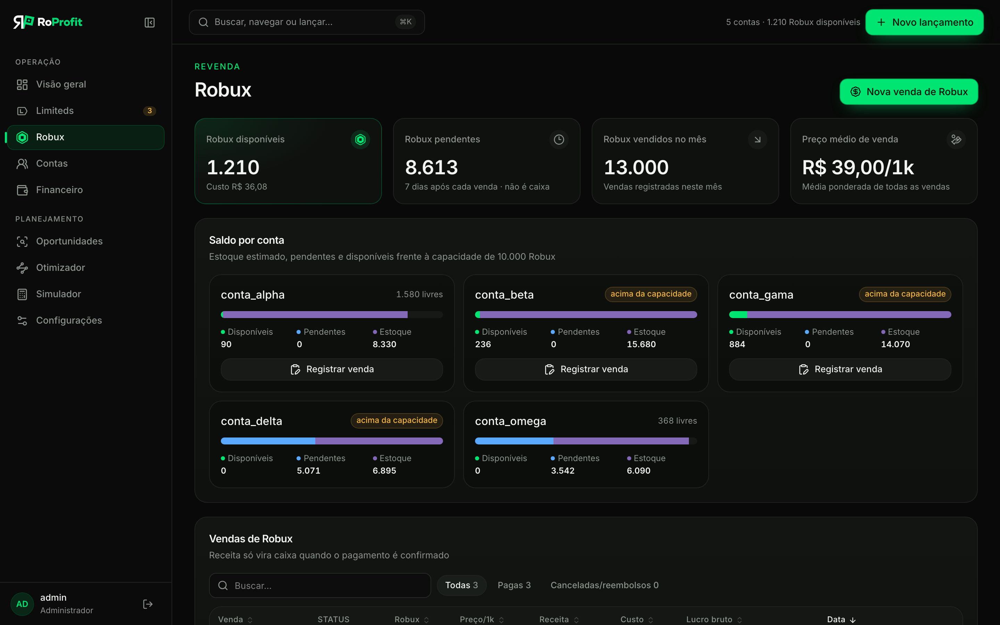 |
| **Financeiro** | **Robux** |

### No celular

  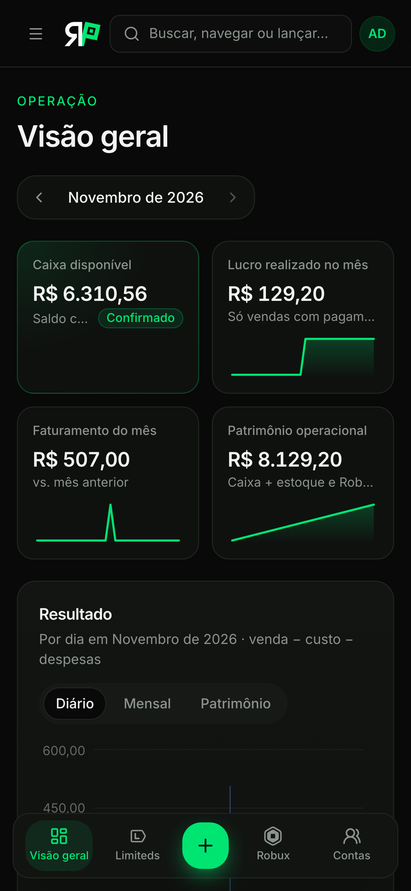
  &nbsp;&nbsp;
  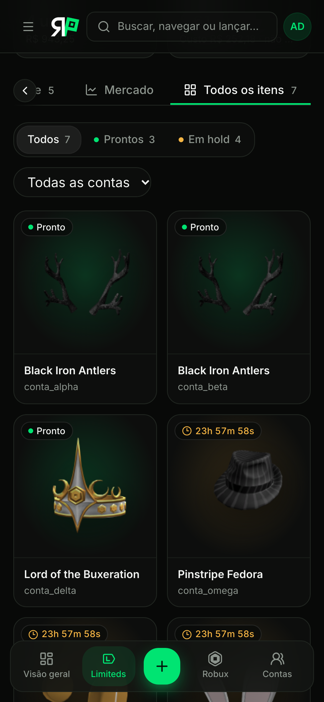

---

## Como funciona o otimizador

O otimizador sugere como distribuir Limiteds entre contas respeitando a capacidade mensal de cada uma. Ele oferece dois modos: acomodar só o que cabe ou distribuir todos os itens minimizando o excedente. O painel indica se a solução encontrada é ótima comprovada ou viável dentro do tempo disponível.

## Direitos de uso

Esta vitrine apresenta o projeto para fins de portfólio. © 2026 RoProfit. Todos os direitos reservados. Consulte o [aviso de direitos autorais](LICENSE).
